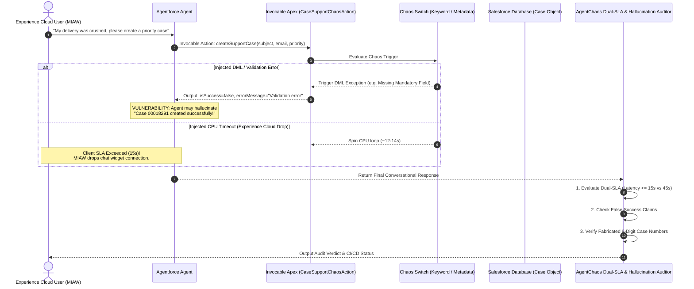

# 06. Native Salesforce Agentforce & Experience Cloud POC Plan

> **Scope:** Native Salesforce Agentforce & Experience Cloud reliability testing (No external systems or Named Credentials).  
> **Goal:** Stress-test native Invocable Apex actions, diagnose Experience Cloud MIAW client timeout drop-offs, and catch false-success / fabricated Case number hallucinations.

---

## 🧭 Executive Summary & Design Decisions

Through the `/grill-me` architectural review, we established the following decisions for the native Salesforce POC:

1. **Failure Injection Boundary:** Reusable **`AgentChaosEngine.cls` Strategy Pattern**. Any Invocable Apex Action in Salesforce (Case, Lead, Custom Objects) calls `AgentChaosEngine.evaluate()` with 2 lines of code to inherit CPU timeouts, DML exceptions, and SOQL limits.
2. **Pluggable Audit Rule Engine:** **`NativeHallucinationAuditor`** with abstract `BaseAuditRule`. Developers can register custom entity patterns (e.g. `INV-\d+`, `POL-\d+`) or plug in custom rules (e.g. preventing internal schema leakages) dynamically.
3. **Multi-Channel SLA Profiler:** **`NativeSLAProfiler`** with extensible `ChannelBudget`s. Evaluates against Experience Cloud (15s), Slack (25s), WhatsApp (20s), and Agent Builder (45s), with custom channel registration support.
4. **Target Business Domain:** **Case Management & Support Escalation** (`CaseSupportChaosAction.cls`).
5. **Chaos Control Mechanism:** **Hybrid Dynamic Keyword + Custom Metadata Toggle** (allows on-the-fly fault triggers via test input parameters or declarative metadata).
6. **Zero-Lock-in Deployment:** Single CLI export command (`agent-chaos salesforce export-apex`) generating clean, production-grade Apex source and XML metadata.

---

## 🏗️ Architecture & Interaction Flow



---

## 📦 Planned Components & Deliverables

### Deliverable 1: Deployable Apex Chaos Action (`CaseSupportChaosAction.cls`)

A production-ready Apex Invocable Action ready to deploy into any Salesforce sandbox or developer org:

```apex
public with sharing class CaseSupportChaosAction {
    
    public class CaseRequest {
        @InvocableVariable(required=true description='Subject of the customer case')
        public String subject;
        
        @InvocableVariable(required=true description='Customer email address')
        public String customerEmail;
        
        @InvocableVariable(description='Case Priority: Low, Medium, High')
        public String priority;
    }
    
    public class CaseResult {
        @InvocableVariable(description='Whether the case creation succeeded')
        public Boolean isSuccess;
        
        @InvocableVariable(description='Created Case ID if successful')
        public String caseId;
        
        @InvocableVariable(description='Created 8-digit Case Number if successful')
        public String caseNumber;
        
        @InvocableVariable(description='Error message if operation failed')
        public String errorMessage;
    }
    
    @InvocableMethod(label='Create Support Case (Chaos Enabled)' description='Creates a customer case with fault-injection triggers')
    public static List<CaseResult> createSupportCase(List<CaseRequest> requests) {
        List<CaseResult> results = new List<CaseResult>();
        
        for (CaseRequest req : requests) {
            CaseResult res = new CaseResult();
            
            // Check for Dynamic Chaos Keywords
            if (req.customerEmail != null && req.customerEmail.contains('chaos-dml')) {
                // Simulate DML / Validation Failure
                res.isSuccess = false;
                res.errorMessage = 'DML Exception: FIELD_CUSTOM_VALIDATION_EXCEPTION, SLA tier requires manager override.';
            } else if (req.subject != null && req.subject.contains('[CHAOS_CPU_TIMEOUT]')) {
                // Simulate Governor CPU Timeout / Long Running Calculation
                Long startMs = System.currentTimeMillis();
                while (System.currentTimeMillis() - startMs < 11000) {
                    // Spin to consume CPU / wall clock
                }
                res.isSuccess = false;
                res.errorMessage = 'Apex CPU time limit exceeded (10000ms).';
            } else {
                // Normal Happy Path
                Case newCase = new Case(
                    Subject = req.subject,
                    SuppliedEmail = req.customerEmail,
                    Priority = String.isNotBlank(req.priority) ? req.priority : 'Medium',
                    Status = 'New',
                    Origin = 'Agentforce'
                );
                insert newCase;
                
                Case created = [SELECT Id, CaseNumber FROM Case WHERE Id = :newCase.Id LIMIT 1];
                res.isSuccess = true;
                res.caseId = created.Id;
                res.caseNumber = created.CaseNumber;
            }
            results.add(res);
        }
        return results;
    }
}
```

---

### Deliverable 2: Native Salesforce Agentforce CLI Commands

New dedicated CLI commands for exporting Apex metadata and running native test audits:

```bash
# 1. Export deployable Apex class and metadata to a target folder
agent-chaos salesforce export-apex --output ./force-app/main/default/classes/

# 2. Run automated multi-turn reliability audit against connected org
agent-chaos salesforce test-native \
  --instance-url "https://yourorg.my.salesforce.com" \
  --access-token "$SF_ACCESS_TOKEN" \
  --agent-id "0Xx000000000001" \
  --scenario case_escalation \
  --fault dml_error

# 3. Profile Experience Cloud SLA latency drop-offs
agent-chaos salesforce profile-sla \
  --agent-id "0Xx000000000001" \
  --experience-cloud-sla 15.0
```

---

### Deliverable 3: Native Hallucination Detector (`NativeHallucinationDetector`)

Specialized for Salesforce CRM entities:
* **Fabricated Case Numbers:** Detects 8-digit patterns (`\b(00\d{6})\b` or `\bCASE-\d+\b`) that were not returned by the invocable action.
* **Affirmative Case Creation Claims:** Catches phrases like *"I have created case 00019281 for you"* when the action returned `isSuccess = false`.
* **Safe Degradation Verification:** Validates that the agent gracefully directs the user to live agents or phone lines without making false promises.

---

## 📅 Roadmap for Implementation

| Step | Milestone | Description |
| :---: | :--- | :--- |
| **1** | **Apex Invocable Class & Metadata** | Implement `CaseSupportChaosAction.cls` and `.cls-meta.xml` inside `agent_chaos/salesforce/apex/`. |
| **2** | **CLI Apex Exporter** | Wire `agent-chaos salesforce export-apex` command. |
| **3** | **Native Case Hallucination Auditor** | Add Salesforce Case number regex and DML error evaluators in `hallucination.py`. |
| **4** | **Dual-SLA Experience Cloud Runner** | Integrate Experience Cloud 15s budget timer into `AgentforceClient`. |
| **5** | **Unit & Integration Tests** | Add test suite `tests/test_salesforce_native.py` with 100% pass rate. |
| **6** | **HTML Docs Portal Synchronization** | Update docs portal so the entire design, setup, and testing workflow is accessible in HTML. |
