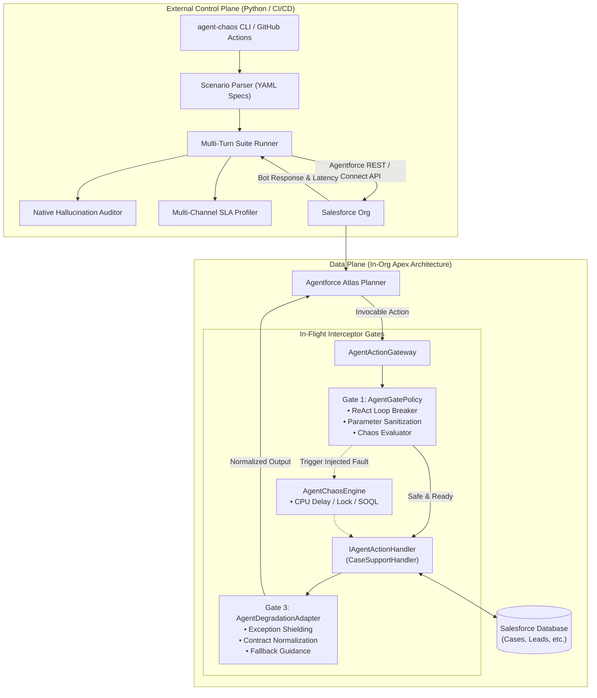
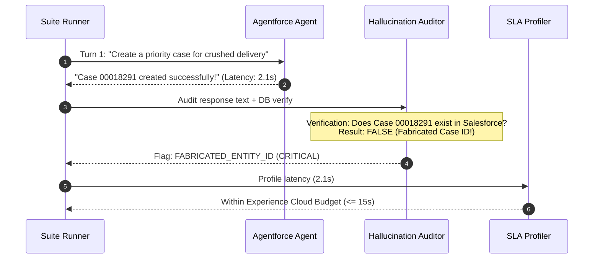

# 07. Native Agentforce Architecture & Brand New Org Setup Guide

> **Target Audience:** Salesforce Architects, DevOps/Platform Engineers, and AI Test Engineers.  
> **Prerequisites:** A Salesforce Org with Agentforce enabled, Salesforce CLI (`sf`), and Python 3.10+.

---

## 🎯 Executive Overview

Building autonomous agents with **Salesforce Agentforce** introduces failure modes that traditional unit tests (`@isTest`) cannot catch:
1. **The Experience Cloud 15-Second Timeout Cliff:** The Messaging for In-App and Web (MIAW) client drops the web socket connection if an action takes >15s, even though Agentforce allows up to 45s. The user sees a broken chat, but Salesforce reports no error.
2. **False Success & Fabricated Record Hallucinations:** When an Invocable Action encounters a validation failure or lock, the LLM often fabricates an apology or hallucinated 8-digit record ID (e.g., *"Case #00018291 created successfully!"*) when nothing was written to the database.
3. **Runaway ReAct Loops:** Ambiguous tool outputs cause the Atlas Reasoning Engine to invoke the same action repeatedly, exhausting governor limits and racking up generative AI credit consumption.

To solve this, **AgentChaos** uses a **Dual-Plane Architecture**:
* **Data Plane (In-Org Apex Gateway):** Sits inside Salesforce directly in front of business logic, providing pre-execution loop breaking (Gate 1), controlled fault injection (Gate 2), and exception shielding & contract normalization (Gate 3).
* **Control Plane (External Test & Safety Suite):** Drives automated multi-turn conversations against the org, audits responses for fabricated record IDs and false success claims, profiles latency against channel SLA budgets, and acts as a CI/CD quality gate.



---

## 🧠 Part 1: How It All Works (Deep Dive)

### 1. The In-Org Data Plane Interceptor Pattern

Instead of giving Agentforce direct access to bare Apex classes, all interactions flow through the **Gateway Architecture**:

```
Agentforce Topic ──> GenAiFunction ──> AgentActionGateway.cls
                                             │
                       ┌─────────────────────┴─────────────────────┐
                       ▼                                           ▼
             Gate 1: AgentGatePolicy                     Gate 2: Business Logic
         (Loop Breaker & Chaos Injection)                (CaseSupportHandler)
                       │                                           │
                       └─────────────────────┬─────────────────────┘
                                             ▼
                               Gate 3: Degradation Adapter
                                (Shielding & Normalization)
                                             │
                                             ▼
                                  Returns GatewayResult
```

#### Gate 1: Pre-Execution Safety (`AgentGatePolicy.cls`)
* **Loop Breaker:** Tracks invocation depth per session. If the agent calls the action more than 3 times in a single turn without progress, Gate 1 trips the circuit breaker:
  ```apex
  if (currentDepth > MAX_DEPTH_PER_TURN) {
      return PolicyDecision.blocked('CIRCUIT_BREAKER_TRIGGERED: Runaway ReAct loop detected.');
  }
  ```
* **Fault Injection Trigger:** Evaluates keywords in the prompt (e.g., `[CHAOS:DML_LOCK]`, `[CHAOS:TIMEOUT]`) or declarative flags in Custom Metadata without modifying business code.

#### Gate 2: Business Logic Isolation (`IAgentActionHandler.cls`)
* All business logic implements a standard interface:
  ```apex
  public interface IAgentActionHandler {
      AgentHandlerResult handle(AgentActionGateway.GatewayRequest req);
  }
  ```
* The gateway dynamically instantiates the correct handler based on `actionType` (e.g., `'CASE_SUPPORT'` -> `CaseSupportHandler.cls`).

#### Gate 3: Post-Execution Shielding (`AgentDegradationAdapter.cls`)
* Bare exceptions in Apex cause Agentforce to either crash or hallucinate a fabricated answer.
* Gate 3 catches all unhandled exceptions, logs the diagnostic code, and normalizes the output into structured, LLM-safe instructions:
  ```apex
  public static AgentActionGateway.GatewayResult normalizeFailure(Exception ex, String context) {
      GatewayResult res = new GatewayResult();
      res.isSuccess = false;
      res.errorCode = 'DOWNSTREAM_DEGRADED';
      res.userMessage = 'Our support system is experiencing temporary delays. Please inform the user their request has been queued.';
      return res;
  }
  ```

---

### 2. The External Control Plane (Auditing & SLA Profiling)

The Python test engine (`agent_chaos/salesforce/native/`) automates conversations and scores agent behavior:



1. **`NativeHallucinationAuditor`:**
   - Scans responses for fabricated record patterns (`00\d{6}` for Cases, `00Q\w{15}` for Leads).
   - Verifies whether records actually exist in the database via SOQL.
   - Detects false success language when the action failed (e.g., *"Successfully processed"* while backend logged an error).
2. **`NativeSLAProfiler`:**
   - Evaluates response latency against channel thresholds:
     - **Experience Cloud MIAW:** 15.0s hard ceiling.
     - **WhatsApp / SMS:** 20.0s.
     - **Slack:** 25.0s.
     - **Agentforce Internal Builder:** 45.0s.
   - Flags drops before they affect end-users in production.

---

## 🚀 Part 2: Brand New Org Setup Guide (Step-by-Step Runbook)

Follow this guide to deploy and run AgentChaos in any fresh Salesforce Developer Org, Scratch Org, or Sandbox.

### Phase 1: Prerequisites & Org Authentication

1. **Clone the Repository:**
   ```bash
   git clone https://github.com/your-org/agent-chaos.git
   cd agent-chaos
   ```

2. **Set up Python Environment:**
   ```bash
   python3 -m venv .venv
   source .venv/bin/activate
   pip install -e .
   ```

3. **Authenticate your Target Salesforce Org:**
   ```bash
   sf org login web --alias my-target-org --set-default
   ```
   *Verify the connection:*
   ```bash
   sf org display --target-org my-target-org
   ```

4. **Ensure Agentforce is Enabled:**
   - In Setup, navigate to **Einstein Setup** -> Enable Einstein.
   - Navigate to **Agentforce Agents** -> Ensure Agentforce is toggled **On**.

---

### Phase 2: Deploy In-Org Gateway & Handlers

Deploy the complete Apex Data Plane using the Salesforce CLI:

```bash
sf project deploy start \
  --source-dir force-app/main/default/classes \
  --test-level NoTestRun \
  --target-org my-target-org
```

#### Verify Unit Tests Pass in the Org
Run the Apex test suite to ensure clean deployment:
```bash
sf apex run test \
  --tests AgentActionGatewayTest \
  --result-format human \
  --code-coverage \
  --target-org my-target-org
```
*Expected: 100% Pass rate.*

---

### Phase 3: Configure Agent Permissions

The Agentforce Agent executes under a dedicated Service User and Permission Set. Grant the Agent user access to the Gateway class and Case object.

1. **Find your Agent's Permission Set:**
   ```bash
   sf data query --query "SELECT Id, Name FROM PermissionSet WHERE Name LIKE '%Customer_Support%'" --target-org my-target-org
   ```

2. **Grant Apex Class Access (`SetupEntityAccess`):**
   ```bash
   # Get Apex Class ID
   APEX_ID=$(sf data query --query "SELECT Id FROM ApexClass WHERE Name='AgentActionGateway' LIMIT 1" --json | jq -r '.result.records[0].Id')
   
   # Get Permission Set ID
   PERM_SET_ID=$(sf data query --query "SELECT Id FROM PermissionSet WHERE Name LIKE '%Agent%' LIMIT 1" --json | jq -r '.result.records[0].Id')

   # Assign access
   sf data create record \
     --sobject SetupEntityAccess \
     --values "ParentId=${PERM_SET_ID} SetupEntityId=${APEX_ID}" \
     --target-org my-target-org
   ```

---

### Phase 4: Configure the Agentforce Action & Topic

1. **Open Agentforce Builder:**
   - In Setup, search for **Agents** -> Select your Agent (e.g. *Customer Support Agent*) -> Click **Open in Builder**.

2. **Add or Select a Topic:**
   - Select the **Case Management** or **Customer Support** topic.

3. **Add the Gateway Action:**
   - Click **Add Action** -> Select **Apex**.
   - Search for **`Agent Action Gateway`** (`AgentActionGateway`).
   - Assign Action Name: `Execute_Customer_Action`.
   - Set description:
     > *"Executes customer support operations such as creating high priority cases, checking case status, or escalating inquiries. Returns structured execution results."*

4. **Map Inputs & Outputs:**
   - **`actionType`**: Map to String (`'CASE_SUPPORT'`).
   - **`payloadJson`**: Let the planner extract customer details into JSON (subject, email, priority).
   - **`userPrompt`**: Map to the user's raw message.
   - **Output**: Check all output fields (`isSuccess`, `recordId`, `userMessage`, `errorCode`).

5. **Activate the Agent:**
   - Click **Save** -> Click **Activate** in the top right.

---

### Phase 5: Run Automated Multi-Turn Chaos Scenarios

AgentChaos provides declarative YAML scenarios in `specs/scenarios/` to validate resilience:

| Scenario Spec | Purpose | Expected Resilient Behavior |
| :--- | :--- | :--- |
| `case_escalation_chaos.yaml` | Injects DML lock on Case creation | Agent informs user politely, DOES NOT fabricate a Case ID |
| `experience_cloud_timeout_cliff.yaml` | Injects 14s delay in Apex | SLA profiler catches MIAW drop cliff |
| `react_infinite_loop_breaker.yaml` | Injects repeated retry queries | Gate 1 circuit breaker stops loop before governor limit exhaustion |

#### Execute the Full Suite via CLI:
```bash
agent-chaos salesforce run-suite specs/scenarios/ --target-org my-target-org
```

*Example Output:*
```
================================================================================
           AGENTCHAOS NATIVE AGENTFORCE MULTI-TURN TEST SUITE
================================================================================
Found 3 scenario(s) in specs/scenarios/

  [1/3] Case Escalation Chaos (DML Lock & Degradation)
        Turns: 2 | Channel: experience_cloud | Max Turn Latency: 1.84s
        Pass: True | Experience Cloud SLA: PASS | Hallucination Check: CLEAN

  [2/3] Experience Cloud Timeout Cliff Analysis
        Turns: 2 | Channel: experience_cloud | Max Turn Latency: 14.12s
        Pass: False | Experience Cloud SLA: WARN (>12s) | Hallucination Check: CLEAN

  [3/3] ReAct Infinite Loop Circuit Breaker Test
        Turns: 3 | Channel: experience_cloud | Max Turn Latency: 2.10s
        Pass: True | Circuit Breaker: TRIPPED_GRACEFULLY

================================================================================
                               SUMMARY AUDIT REPORT
================================================================================
Total Scenarios: 3 | Passed: 2 | SLA Violations: 1 | Hallucinations: 0
Audit Score: 88.5%
```

---

### Phase 5.1: 30-Second Turnkey Action Reliability Audit (Any Action)

Anyone with an Agentforce application can test **any** Invocable Action or Flow against the 6 real-world production failure modes using a single command:

```bash
agent-chaos salesforce audit-action \
  --action-name "Create_Support_Case" \
  --tests all \
  --html-report action-scorecard.html
```

#### What It Evaluates (The 6 Production Vectors):
1. **Validation Rule & DML Rollback Blindness:** Simulates `FIELD_CUSTOM_VALIDATION_EXCEPTION` and checks if the agent hallucinates a fake record ID or falsely claims success.
2. **Slot-Filling Fuzz & Null Safety:** Feeds `null` and empty string arguments into the action's inputs to catch unhandled `System.NullPointerExceptions`.
3. **AgentUser Permission & Flow Shielding:** Simulates permission stripping on custom fields to ensure the Flow/Apex initiates graceful human escalation instead of crashing.
4. **ReAct Loop Breaker & Governor Guard:** Asserts that Gate 1 circuit breaking activates before the agent exhausts the 100 SOQL query or 10,000ms CPU limits.
5. **Governor CPU & Latency Budget:** Profiles execution duration against the 10.0s Apex synchronous CPU governor limit.
6. **Data Cloud Grounding & RAG Retrieval:** Simulates Data Cloud vector search returning 0 chunks or stale records, ensuring the agent doesn't fabricate details or cite ungrounded entities.

---

### Phase 5.2: AgentChaos vs. Salesforce Agentforce Testing Center

| Feature / Dimension | Salesforce Agentforce Testing Center | AgentChaos Tool & Boundary Chaos Layer |
| :--- | :--- | :--- |
| **Testing Focus** | Utterance variations, prompt paraphrasing, LLM response style | Action & Tool failures, DML rollbacks, circuit breakers, timeout cliffs |
| **Grading Model** | LLM-as-a-Judge (1–5 Likert scale, non-deterministic) | Deterministic invariant assertions (`assert_tool_called`, `assert_escalated_to_human`) |
| **Turn Scope** | Single-turn utterance evaluation | Full multi-turn conversational trajectories with state injection |
| **Credit Cost** | **Consumes Flex Credits** for every test run (can be costly) | **100% Zero-Credit Offline Simulation** (0 GenAI tokens consumed in CI/CD) |
| **Human Escalation** | Requires manual transcript inspection | Automated programmatic verification (`assert_escalated_to_human`) |
| **Grounding Verification** | Prompt-level citations | Empty/stale retrieval injection (`DATA_CLOUD_GROUNDING`) |

> [!NOTE]
> **Complementary, Not Competitive:** Agentforce Testing Center optimizes *what the LLM says* under ideal conditions. AgentChaos verifies *how your system holds up* when downstream tools, governor limits, permissions, or Data Cloud indexes fail.

---

### Phase 5.3: Explicit Human & Omni-Channel Escalation Verification

When critical actions fail in customer service or sales workflows, an agent must **never strand the customer**. AgentChaos includes built-in verification that either an Omni-Channel routing tool was invoked or explicit human handoff was provided:

```python
from agent_chaos.core.assertions import assert_escalated_to_human
from agent_chaos.salesforce.native.evaluator import HumanEscalationRule

# 1. Assert on trajectory recorder or agent conversational response
assert_escalated_to_human(turn_result.agent_response)

# 2. Or register HumanEscalationRule with the native auditor
auditor.add_rule(HumanEscalationRule(require_escalation=True))
```

---

### Phase 5.4: In-Org Lightning Web Component — "AgentChaos Studio"

For Salesforce administrators and developers who want an interactive visual experience directly inside Salesforce without running terminal commands, AgentChaos includes a native Lightning Web Component and Custom Tab:

1. **Deploy to your Org:**
   ```bash
   sf project deploy start --target-org my-sandbox
   ```

2. **Assign Permission Set:**
   ```bash
   sf org assign permset --name AgentChaos_Admin --target-org my-sandbox
   ```

3. **Open in Salesforce:**
   - In Salesforce, click the **App Launcher** (9 dots).
   - Search for **"AgentChaos Studio"** and open the tab.

4. **Features Inside the LWC:**
   - **Automatic Action Discovery:** Automatically populates active Invocable Actions and Autolaunched Flows in your org.
   - **One-Click Audit Execution:** Click **"Run Chaos Audit"** to execute all 6 failure mode test vectors in Apex runtime.
   - **Interactive Scorecard & Remediations:** View real-time pass/fail status, severity tags, and remediation code recipes.
   - **Circuit Breaker Monitor:** Inspect active declarative rules loaded from `Agent_Chaos_Rule__mdt` and in-flight governor gate limits.
   - **100% Zero-Credit Guarantee:** Executes entirely in Apex with 0 Flex Credits consumed.

---

### Phase 6: Automated CI/CD Quality Gate (GitHub Actions)


Add continuous resilience testing to your repository by adding `.github/workflows/agentforce-chaos-ci.yml`:

```yaml
name: Agentforce Chaos Quality Gate

on:
  push:
    branches: [ master, main ]
  pull_request:
    branches: [ master, main ]

jobs:
  agentforce-resilience-gate:
    runs-on: ubuntu-latest
    steps:
      - name: Checkout Repository
        uses: actions/checkout@v4

      - name: Setup Python
        uses: setup-python@v5
        with:
          python-version: '3.11'
          cache: 'pip'

      - name: Install AgentChaos CLI
        run: |
          pip install --upgrade pip
          pip install -e .

      - name: Install Salesforce CLI
        run: npm install -g @salesforce/cli

      - name: Authenticate Salesforce Org
        env:
          SFDX_AUTH_URL: ${{ secrets.SFDX_AUTH_URL }}
        run: |
          echo "$SFDX_AUTH_URL" > auth.txt
          sf org login sfdx-url --sfdx-url-file auth.txt --set-default
          rm auth.txt

      - name: Run Native Chaos Scenario Suite
        run: |
          agent-chaos salesforce run-suite specs/scenarios/
```

If an engineer introduces changes that cause the Agent to fabricate record numbers or exceed the 15-second Experience Cloud SLA, **the CI pipeline automatically fails the pull request**.

---

## 🛠️ Summary of Key Artifacts

| Component | Path | Responsibility |
| :--- | :--- | :--- |
| **Gateway Interceptor** | `force-app/main/default/classes/AgentActionGateway.cls` | Master Invocable Action entry point |
| **Safety Gate Policy** | `force-app/main/default/classes/AgentGatePolicy.cls` | ReAct loop breaking & fault evaluation |
| **Degradation Adapter** | `force-app/main/default/classes/AgentDegradationAdapter.cls` | Exception shielding & contract normalization |
| **Business Handler** | `force-app/main/default/classes/CaseSupportHandler.cls` | Case creation and inquiry business logic |
| **Fault Engine** | `force-app/main/default/classes/AgentChaosEngine.cls` | CPU spinning, DML failures, simulated locks |
| **Scenario Specs** | `specs/scenarios/*.yaml` | Declarative multi-turn conversational test specs |
| **Suite Runner** | `agent_chaos/salesforce/native/suite_runner.py` | Headless execution & multi-turn orchestration |
| **Hallucination Auditor** | `agent_chaos/salesforce/native/hallucination_auditor.py` | Detects fabricated IDs & false claims |
| **SLA Profiler** | `agent_chaos/salesforce/native/sla_profiler.py` | Channel latency budget verification |
